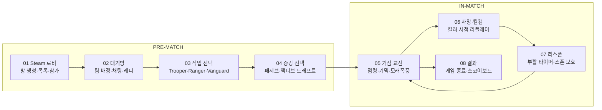
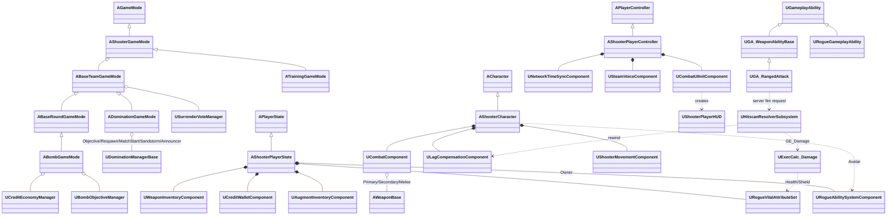

# DUST BASE

> **직업과 증강으로 매 판 전략이 달라지는 팀 점령전 FPS**
>
> 내일배움캠프 Unreal 8기 4조 최종 프로젝트 · Unreal Engine 5.7 · C++ · GAS · Steam 멀티플레이

`4v4 팀 대전 FPS` `로그라이크 증강` `Gameplay Ability System` `서버 권위 히트스캔 + 랙 보상` `Steam 멀티플레이`

| 🎬 Game Trailer | 🎮 Game Play |
|---|---|
| [YouTube](https://youtu.be/YOfqYJDxFtg) | [YouTube](https://youtu.be/4ZRP9fDed2o) |

---

## 게임 소개

| 항목 | 내용 |
|---|---|
| 장르 | 로그라이크 증강 기반 팀 대전 전술 FPS |
| 플랫폼 | PC (Windows, Steam) |
| 플레이 타임 | 점령 모드 1판 약 10~15분 |
| 플레이 인원 | 2~8인 (최대 4 vs 4, 팀당 최소 1명) |
| 개발 기간 | 2026.08.04 ~ 2026.10.14 (약 10주) |
| 규모 | 8명, 커밋 약 1,450개 |

Dust Base는 Steam 로비에서 방을 만들고 친구들과 4대4로 맞붙는 1인칭 전술 슈터입니다.
총싸움에 로그라이크 증강을 섞어, 같은 무기를 들어도 판마다 전혀 다른 전투가 펼쳐집니다.

### 점령 모드 (Domination / 맵: Skyline)
- A~E 5개 거점 중 중앙 **C에서 시작해 전선을 밀어내는** 리스폰 거점전. **3점을 먼저** 따면 승리
- 거점을 점령할 때마다 **증강 획득**
- 점령 속도는 인원에 비례: 1명 30초 / 2명 22초 / 3명 이상 15초
- 병과 3종: **Trooper**(돌격소총) · **Ranger**(저격소총) · **Vanguard**(산탄총)
- 거점 기믹(정찰 단말, 리스폰 중계 비콘)과 주기적인 **모래폭풍** 이벤트로 시야 방해

### 훈련 모드
- 자유 연습장, 반응 속도 아레나, StateTree AI와 싸우는 **CQB 훈련장**

### 증강 104종
- **액티브**: 블레이드 드론, 힐링 드론, 연막, 스캔 …
- **패시브**: 흡혈, 2단 점프, 자폭 …
- **무기 전용**: 레일건, 드래곤 브레스 …

조합으로 **"이번 판의 내 빌드"** 를 만들어 가는 것이 핵심 재미입니다.

### 한 판의 흐름



---

## 기획 의도

- **정형화된 전술 FPS의 피로감 해소**
  라운드제 전술 슈터는 메타가 굳으면 매판 같은 운영이 반복됩니다. 로그라이크 증강으로 라운드마다 빌드가 바뀌고, 상대 증강에 맞춰 대응을 바꾸는 의사결정의 재미를 더했습니다.
- **"쏘는 맛"과 공정한 판정**
  서버 권위 히트스캔 + 랙 보상, 히트마커(헤드/쉴드/바디), 킬 이펙트, 멀티킬 사운드, 킬캠으로 네트워크 환경 차이 속에서도 납득할 수 있는 타격감을 목표로 했습니다.

---

## 핵심 기능

### 01 · 점령전 게임모드 (Domination)
- **거점 점령 & HUD**: 점령 진행률과 점령 중인 인원 표시, 미니맵·전체맵에 거점 상태 반영
- **거점 기믹**: C 정찰 단말 · B/D 중계 비콘 확보 시 이펙트와 음성 안내, C 진행률에 연동된 격납고 셔터
- **모래폭풍 & 스폰 보호**: 모래폭풍 속 적 아웃라인 가시거리 제한, 아군만 통과하는 스폰 장벽, 레이트 조인 대응

### 02 · 직업과 GAS 기반 전투
- **직업 3종**: Trooper · Ranger · Vanguard, 직업별 V 궁극기와 전용 음성, 직업별 액티브 증강 제한
- **무기 & 투척물**: 라이플 · 스나이퍼 · 샷건 · 권총 · 칼, 튕김 궤적이 있는 투척물 4종과 연막
- **이동과 사격감**: 스태미너 기반 달리기 예측 동기화, 이동 · ADS · 앉기에 따른 반동과 탄퍼짐

### 03 · 매 판 빌드가 바뀌는 증강
- **데이터 기반 증강**: 운명의 주사위 · 기합의 띠 · 헤드헌터 챔버 · 냉각 장치 등을 코드 없이 데이터 에셋으로 추가
- **조건부 대미지 규칙**: 거리 단계 · 헤드샷 · 마지막 탄 · 발동 확률 · 무작위 배율을 조합해 효과 정의
- **액티브 증강 연출**: 드래곤브레스 · 드론 소환, 1인칭/3인칭 시전 애니메이션과 GameplayCue 사운드

### 04 · 킬러 시점으로 다시 보는 킬캠
- **리플레이 기반 재생**: 매치를 계속 녹화해 두고, 사망 시 `KillcamReplaySubsystem`이 킬러 시점을 재생
- **1인칭 연출 재현**: 킬러의 1인칭 무기 · 스코프 · 장전 · 반동 모션까지 그대로 표시
- **관전 & 리스폰**: 킬캠이 끝나면 부활 타이머와 함께 관전

### 05 · 맞췄다는 느낌을 주는 전투 피드백
- **부위별 히트마커**: 헤드샷 > 쉴드 > 바디 우선순위로 판정해 부위마다 다른 색상과 사운드
- **킬 피드백**: 킬로그 · 킬 이펙트 · 헤드샷 처치 사운드
- **상황판 HUD**: 미니맵 · 전체맵 · 거점 트래커 · HP/쉴드 바 · 증강 · 스코어보드

### 06 · 함께 플레이하기 위한 기능들
| 기능 | 내용 |
|---|---|
| 채팅 | 대기방 · 캐릭터 선택 · 인게임 채팅, 팀/귓말 채널 |
| 보이스챗 | 팀 음성 채팅과 말하는 중 아이콘 표시 |
| 캐릭터 커스터마이징 | MetaHuman 외형 커스터마이징, 직업 선택 프리뷰에 반영 |
| 훈련장 CQB 모드 | 직업을 골라 근접 전투를 연습하는 훈련 시스템 |
| 게임 옵션 | 해상도 · 밝기 · 사운드 · 앉기/ADS 토글 · 크로스헤어 색상 |
| 로딩 & 트랜지션 | 맵 이동 로딩 화면, 에셋 비동기 프리로드, 화면 전환 연출 |

---

## 기술 스택

| 분류 | 내용 |
|---|---|
| Engine | Unreal Engine 5.7 |
| Language | C++ (+ Blueprint) |
| IDE | Visual Studio 2022 / JetBrains Rider |
| VCS | Git + Git LFS (Lock 기반 에셋 관리), GitHub PR 리뷰 |
| Network | OnlineSubsystemSteam, SteamSockets NetDriver (fallback IpNetDriver), Listen Server |
| Plugins | Gameplay Ability System, CommonUI, Enhanced Input, StateTree / GameplayStateTree, Mutable, MetaHuman Character, Animation Warping, Niagara, Python Script / Editor Scripting Utilities |
| Collaboration | Notion, Slack, Unreal Multi-User Editing |

<details>
<summary>사용 마켓플레이스 에셋</summary>

- KINEMATION – Tactical Shooter Pack
- Infima Games – Modern Guns Bundle, Tactical FPS Animations
- Knife FPS Animations
- Fab – FC Military Camp, Military Airport, Megascans
- Fab – Realistic Starter VFX Pack Vol.2, Fire EXP Vol.01, Vefects Easy Shockwaves VFX, Niagara Examples
- Fab – MetaHuman 의상 (Mercenary, Futuristic Bounty Hunter Jacket & Armor, MetaHuman Jeans)
- Epic – MetaHuman, Lyra 샘플 사운드, Level Prototyping

</details>

---

## 아키텍처



### 주요 클래스

| 클래스 | 역할 |
|---|---|
| `AShooterGameMode` → `ABaseTeamGameMode` → `ADominationGameMode` / `ABombGameMode` | 팀 배정, 항복 투표, 모드별 규칙. 점령 모드는 매니저 UObject로 책임 분리 |
| `ABaseTeamGameState` 계열 | 라운드 페이즈, 점수, 거점 상태 등 매치 상태 복제 |
| `AShooterPlayerState` | ASC Owner. AttributeSet 3종(Vital/Augment/Ammo), 증강 인벤토리, 크레딧 지갑, 상점, 무기 인벤토리 → 리스폰해도 상태 유지 |
| `AShooterCharacter` | ASC Avatar. 1인칭 카메라·Mesh1P, CombatComponent, LagCompensationComponent, 외형 컴포넌트 |
| `UShooterMovementComponent` | FSavedMove 확장으로 달리기 예측 |
| `UCombatComponent` | 무기 슬롯(주/보조/근접) 복제, 장착, ADS 상태 |
| `AWeaponBase` | 1P/3P 메시, 탄약 복제, 이펙트·조준 컴포넌트 |
| `UGA_WeaponAbilityBase` 계열 | 사격 / 근접 / 재장전 / ADS / 무기 교체 (LocalPredicted) |
| `URogueGameplayAbility` 계열 | 증강 스킬 (Dash, SpawnActor, Effect, AddAmmo, SmokeSight) |
| `UHitscanResolverSubsystem` | 서버 히트스캔 검증 → 랙 보상 되감기 → 데미지 컨텍스트 생성 |
| `UExecCalc_Damage` / `URogueDamageSubsystem` | 단일 데미지 파이프라인 (부위·거리·쉴드·조건부 규칙) |
| `UAugmentDefinition` / `UAugmentDraftManager` | 증강 데이터 정의 / 등급 가중치 추첨 |
| `UKillcamReplaySubsystem` | 인메모리 리플레이 녹화·재생 (LocalPlayerSubsystem) |
| `USessionSubSystem` | Steam 세션 생성·검색·참가, Seamless Travel |
| `UShooterPrimaryGameLayout` / `UShooterActivatableWidget` | CommonUI 레이어 루트 / 화면 베이스 |

### 폴더 구조

```text
Source/FPS/
├─ Abilities/      무기 GA (사격·근접·재장전·ADS·교체), 데이터잭/거점 홀드 GA
├─ Actor/          거점·게이트·데이터잭·픽업·관통 벽 등 월드 액터
├─ Animation/      AnimInstance, AnimNotify (발소리·총기 사운드)
├─ Augment/        증강 정의·추첨·인벤토리·Rogue 어빌리티·투척/설치 액터
├─ Character/      ShooterCharacter, MovementComponent, 외형 컴포넌트
├─ Chat/           팀/전체/귓속말 채팅 라우팅
├─ Combat/         CombatComponent, 랙 보상, 히트스캔 리졸버, 히트존
├─ Customization/  MetaHuman/Mutable 커스터마이징 스튜디오, Steam Cloud 저장
├─ Data/           무기·데미지 데이터 에셋
├─ Economy/ Shop/  크레딧 지갑·경제 매니저 / 상점 카탈로그·구매
├─ GameMode/       GameMode·GameState·Manager·Rules·Types
├─ GAS/            ASC, AttributeSet, 데미지 ExecCalc, GameplayCue
├─ Killcam/        리플레이 서브시스템, 킬캠 카메라, 커스텀 GameEngine
├─ Minimap/ Ping/  미니맵 자동 생성 / 핑 마커
├─ Player/         PlayerController·PlayerState·관전 폰·시간 동기화
├─ Session/ Travel/ Loading/ Preload/   Steam 세션·이동·로딩·프리로드
├─ Settings/       GameUserSettings, 키 리바인딩
├─ Training/       훈련 모드 (타깃, StateTree 봇, CQB AI)
├─ UI/             CommonUI 레이아웃·HUD·아웃게임 화면
├─ Voice/          Steam 보이스
└─ Weapon/         WeaponBase, 이펙트·조준, 무기 인벤토리

Content/
├─ FPS/            프로젝트 공용 (GAS, Augments, UI, Weapon, DA)
├─ Maps/           StartupMap, Lobby, BombMap, DominationMap, TrainingMap, TransitionMap
├─ MetaHumans/ Characters/ Weapons/ Audio/ Effects/
├─ Developers/[이름]   개인 테스트 영역
└─ Fab/ KINEMATION/ InfimaGames/ Vefects/ ...   마켓 에셋
```

---

## 트러블슈팅

<details>
<summary><b>01 · REPLAY</b> — 킬캠에서 킬러의 총이 보이지 않았다</summary>

- **문제**: 킬캠 초반에 킬러의 총이 보이지 않고, 1인칭 장전 · 스왑 · 반동이 재생되지 않았으며, 연사가 끊겨서 재생됨
- **원인**
  - 녹화 재시작이 복제 레벨 컬렉션에서 실행돼 라이브 액터가 녹화에서 빠짐
  - 1P/3P 분기가 `IsLocallyControlled` 기준이라 킬캠에선 3인칭으로 처리
  - `net.MaxRPCPerNetUpdate=2` 때문에 사격 RPC가 2발씩 묶이고 나머지 유실
- **해결**
  - 라이브 레벨 컬렉션 컨텍스트에서 녹화 재시작
  - `IsFirstPersonPresented()`를 추가해 1인칭 연출 분기 교체
  - 사격 멀티캐스트 수신 시 `ForceNetUpdate` 호출
- **결과**: 킬러의 1인칭 무기 · 스코프 · 반동 · 연사가 킬캠에서 그대로 재생

</details>

<details>
<summary><b>02 · NETWORK</b> — 연사할 때 사격음이 끊겼다</summary>

- **문제**: 원격 클라이언트가 라이플을 연사하면 탄약은 줄어드는데 사격음과 이펙트가 중간중간 빠짐
- **원인**
  - 예측 발사 요청이 네트워크 지터로 서버 기준 발사 간격보다 조금 일찍 도착 → 서버가 거절
  - 쿨다운을 실제 발사 시각 기준으로 잡아 프레임 · 패킷 지연이 매 발 누적
- **해결**
  - 서버가 원격 요청에 발사 간격의 30%만큼 조기 도착을 허용
  - 연사 중에는 직전 발의 예정 시각을 기준으로 다음 쿨다운 계산
- **결과**: 연사 사격음이 끊기지 않고, 지속 연사 속도는 무기 RPM을 넘지 않음

</details>

<details>
<summary><b>03 · COLLABORATION</b> — 병합 한 번에 맵 액터 270개가 깨졌다</summary>

- **문제**: dev 병합 후 World Partition 맵(DominationMap)의 외부 액터 파일 270개가 깨져 맵이 정상적으로 열리지 않음
- **원인**: LFS 머지 드라이버가 제대로 동작하지 않아 실제 LFS 오브젝트에 conflict marker 텍스트가 그대로 커밋됨
- **해결**: 정상 버전이 남아 있던 `feat-LevelDesign-v2` 브랜치를 기준으로 268개 복구, 이미 삭제된 액터 2개 제거

</details>

<details>
<summary><b>04 · ENCODING</b> — Steam 방 목록에서 한글이 깨졌다</summary>

- **문제**: Steam으로 만든 방의 한글 이름이 방 목록에서 깨진 글자로 표시됨 (에디터 PIE에서는 정상)
- **원인**: Steam OSS가 문자열 세션 설정을 `ANSI_TO_TCHAR`로 읽어서, UTF-8 한글이 바이트마다 U+FF80~FFFF 문자 하나로 변환됨
- **해결**: 방 목록을 만드는 `BuildRoomInfoList`에서 RoomName만 UTF-8로 복원하고, NULL OSS(PIE) 문자열은 그대로 유지
- **결과**: Steam과 에디터 양쪽에서 한글 방 이름이 정상 표시

</details>

---

## 실행 방법

1. [**DustBase.zip 다운로드 (Google Drive)**](https://drive.google.com/file/d/1P7Kks071e7xaSB0cWPkvCURpRjdH51CU/view?usp=sharing)
2. 압축 해제 후 **`DUSTBASE.exe`** 실행
3. 멀티플레이는 Steam 클라이언트를 실행한 상태에서 플레이

---

## 팀 소개

| 이름 | 담당 |
|---|---|
| 박광훈 | 무기·전투 시스템(사격, 조준, 반동, 무기 교체)과 히트마커·피격 표시 등 전투 피드백, 핑·채팅·미니맵 |
| 최정빈 | 기획, 거점 기믹, 임팩트·발소리 등 레벨 마감 |
| 조범근 | CommonUI 기반 로비·HUD·스코어보드·증강 선택 등 UI 전반과 UI 최적화 |
| 전지원 | 점령전 맵 제작, 스폰·아이템 배치, 점령 VFX와 조명 |
| 오성현 | 메타휴먼 캐릭터, 커스터마이징, 1·3인칭 애니메이션, LOD 최적화 |
| 차재현 | 대미지 계산 로직, 증강 시스템(추첨·리롤), 액티브 스킬, 사운드 정리 |
| 김형인 | 히트스캔 판정, 점령전 라운드 흐름과 스폰, 훈련장 |
| 조재혁 | 보이스챗, 관전·킬캠, 로딩 동기화 등 네트워크 기능과 사운드 |

---

## 아쉬운 점과 향후 계획

| 아쉬운 점 | 향후 계획 |
|---|---|
| 폴리싱 부족 | 신규 맵 추가 |
| 증강 개수 부족 | 직업 · 증강 추가 |
| 폭파전 개발 | 직업 · 무기 밸런싱 |

### 추후 기술적 도전

- **데디케이티드 서버 전환**: Listen Server의 호스트 이점·호스트 이탈 문제 해소, 매치메이킹 도입
- **서버 사이드 치트 방지 강화**: 사격 요청 시간값 검증(허용 RTT), 연사 속도 검증, 랙 보상 되감기 최대 시간 제한
- **PvP 봇 도입**: CQB StateTree AI를 확장해 빈자리를 채우는 봇
- **증강 밸런싱 데이터 수집**: 증강별 선택률·승률 텔레메트리 → 추첨 가중치 조정
- **리플레이 확장**: 킬캠 인메모리 리플레이 → 하이라이트 저장·경기 다시보기
- **성능 최적화**: MetaHuman LOD/Groom 최적화, Iris Replication 검토, 증강 VFX 풀링
