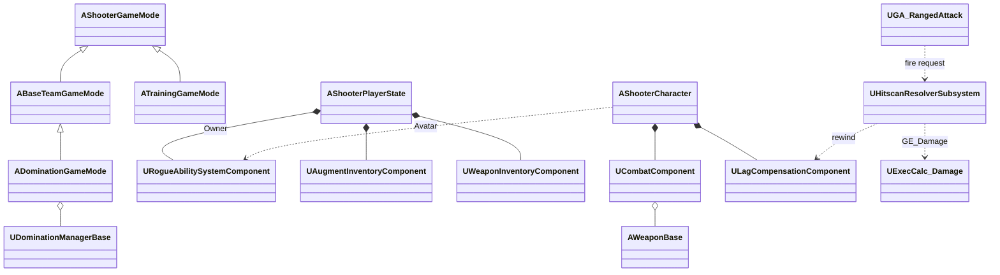

# DUST BASE

> **직업과 증강으로 매 판 전략이 달라지는 4v4 팀 점령전 FPS**
>
> 내일배움캠프 Unreal 8기 4조 최종 프로젝트 · Unreal Engine 5.7 · C++ · GAS · Steam

🎬 [Game Trailer](https://youtu.be/YOfqYJDxFtg) · 🎮 [Game Play](https://youtu.be/4ZRP9fDed2o)

## 실행 방법

1. [**DustBase.zip 다운로드 (Google Drive)**](https://drive.google.com/file/d/1P7Kks071e7xaSB0cWPkvCURpRjdH51CU/view?usp=sharing)
2. 압축 해제 후 **`DUSTBASE.exe`** 실행 (멀티플레이는 Steam 실행 상태에서)

## 게임 소개

| 장르 | 플랫폼 | 인원 | 플레이 타임 | 개발 기간 |
|---|---|---|---|---|
| 로그라이크 증강 팀 점령전 FPS | PC (Steam) | 최대 4 vs 4 | 1판 약 10~15분 | 2026.08.04 ~ 10.14 (8명) |

Steam 로비에서 방을 만들어 4대4로 맞붙는 1인칭 슈터입니다. 같은 무기를 들어도 **직업과 증강 조합**에 따라 판마다 다른 전투가 펼쳐집니다.

- **점령 모드**: A~E 5개 거점, 중앙 C에서 시작해 전선을 밀어내고 3점을 먼저 따면 승리. 점령할 때마다 증강 획득
- **직업 3종**: Trooper(돌격소총) · Ranger(저격소총) · Vanguard(산탄총), 직업별 궁극기
- **증강 104종**: 드론·연막·스캔 같은 액티브, 흡혈·2단 점프 같은 패시브, 레일건·드래곤 브레스 같은 무기 전용
- **훈련 모드**: 자유 연습장, 반응 속도 아레나, StateTree AI와 싸우는 CQB 훈련장

**한 판의 흐름**: Steam 로비 → 대기방 → 직업 선택 → 증강 선택 → 거점 교전 → 킬캠 → 리스폰 → 결과

## 핵심 기능

| 기능 | 내용 |
|---|---|
| 점령전 | 진행률·인원 HUD, 거점 기믹(정찰 단말·중계 비콘·격납고 셔터), 모래폭풍, 아군 전용 스폰 장벽 |
| GAS 전투 | 라이플·스나이퍼·샷건·권총·칼, 투척물 4종, 달리기 예측, 이동·ADS·앉기별 반동과 탄퍼짐 |
| 증강 | 코드 없이 데이터 에셋으로 추가, 거리·헤드샷·마지막 탄·확률 조건부 대미지 규칙 |
| 킬캠 | 인메모리 리플레이로 킬러의 1인칭 무기·스코프·반동까지 재생 후 관전 |
| 판정 & 피드백 | 서버 권위 히트스캔 + 랙 보상, 부위별 히트마커, 킬 이펙트·사운드 |
| 소셜 & QoL | 팀/귓말 채팅, 보이스챗, MetaHuman 커스터마이징, 게임 옵션, 비동기 프리로드 |

## 기술 스택

| 분류 | 내용 |
|---|---|
| Engine | Unreal Engine 5.7, C++ / Blueprint |
| Gameplay | Gameplay Ability System, StateTree, Enhanced Input, Animation Warping |
| UI / Visual | CommonUI, Niagara, MetaHuman, Mutable |
| Network | OnlineSubsystemSteam, SteamSockets, Listen Server |
| VCS | Git + Git LFS (Lock 기반 에셋 관리) |

아키텍처

- **PlayerState가 ASC Owner**: 증강·무기·크레딧이 리스폰 후에도 유지
- **단일 데미지 파이프라인**: 히트스캔 서버 검증 → 랙 보상 되감기 → `UExecCalc_Damage`
- **점령 모드 매니저 분리**: Objective / Respawn / Sandstorm 등 책임별 UObject

## 트러블슈팅

| 문제 | 원인 → 해결 |
|---|---|
| 킬캠에서 킬러의 총·1인칭 모션이 안 보임 | 복제 레벨에서 녹화 재시작, `IsLocallyControlled` 분기 → 라이브 컨텍스트 녹화, `IsFirstPersonPresented()` 추가, 사격 시 `ForceNetUpdate` |
| 연사 시 원격 사격음이 끊김 | 지터로 조기 도착한 요청을 서버가 거절 → 발사 간격 30% 조기 허용, 예정 시각 기준 쿨다운 |
| 병합 후 맵 액터 270개 손상 | LFS 머지 드라이버 오작동으로 conflict marker 커밋 → 정상 브랜치 기준 268개 복구 |
| Steam 방 목록 한글 깨짐 | Steam OSS의 `ANSI_TO_TCHAR` 변환 → `BuildRoomInfoList`에서 UTF-8 복원 |

## 팀 소개

| 이름 | 담당 |
|---|---|
| 박광훈 | 무기·전투 시스템, 전투 피드백, 핑·채팅·미니맵 |
| 최정빈 | 기획, 거점 기믹, 임팩트·발소리 등 레벨 마감 |
| 조범근 | CommonUI 기반 UI 전반과 UI 최적화 |
| 전지원 | 점령전 맵 제작, 스폰·아이템 배치, 점령 VFX와 조명 |
| 오성현 | 메타휴먼 캐릭터, 커스터마이징, 1·3인칭 애니메이션 |
| 차재현 | 대미지 계산, 증강 시스템, 액티브 스킬, 사운드 정리 |
| 김형인 | 히트스캔 판정, 점령전 라운드 흐름과 스폰, 훈련장 |
| 조재혁 | 보이스챗, 관전·킬캠, 로딩 동기화 등 네트워크 |

## 향후 계획

신규 맵 · 직업/증강 추가 · 밸런싱 · 폭파전 완성 · 데디케이티드 서버 전환
